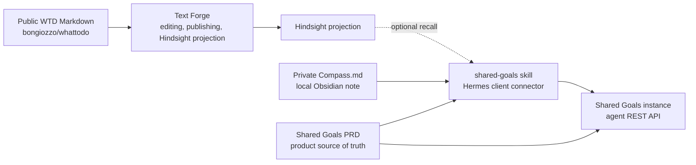

# Shared Goals — AI Companion Skills

These Hermes skills let an agent work with the [Shared Goals platform](https://github.com/shared-goals/instance) on a user’s behalf. The platform stores goals, contracts, and commits. A user’s writing supplies a different kind of context: [Text Forge](https://github.com/shared-goals/text-forge) can project a Markdown collection such as [*What to Do?* (WTD)](https://github.com/bongiozzo/whattodo) into Hindsight. The agent can then retrieve relevant passages, and the person and agent can refer to the same source when deciding what to do next. Neither WTD nor Hindsight is required to use the platform API.

## Shared Goals Repository Map

Read the repositories in this order when you need the whole system context:

1. [shared-goals/prd](https://github.com/shared-goals/prd) — product decisions, acceptance criteria, implementation contract, history, and research.
2. [shared-goals/instance](https://github.com/shared-goals/instance) — platform API, persistence, authentication, and backend tests.
3. [shared-goals/skill](https://github.com/shared-goals/skill) — Hermes skill set and local client connector for agents.
4. [shared-goals/text-forge](https://github.com/shared-goals/text-forge) — Markdown tooling, Obsidian helpers, publishing, inventory, and Hindsight projection.
5. [bongiozzo/whattodo](https://github.com/bongiozzo/whattodo) — public WTD Markdown text and laptop operator workflow.

This repository owns the Hermes skills and local client connector. The canonical component map lives in `shared-goals/prd`.

## Architecture Boundary

The WTD workflow illustrates two distinct uses of Markdown:

- **Private context:** `Compass.md` is a local Obsidian note. It is used by the
	agent as working context for Shared Goals commits, next steps, and explicit
	user-approved updates. The note itself stays local. The connector sends structured requests to the platform API; Daily Compass can also send derived context to the configured model and deliver its report to Telegram when sending is enabled.
- **Public context:** the WTD repository (`bongiozzo/whattodo`) is a public
	collection of reflective essays. `wtd-content-analyze` uses Hindsight to
	find relevant ideas and checks quotations against the published text or
	source checkout. The text, not the memory projection, is authoritative.

This repo is the Hermes client connector for the Shared Goals platform. It does
not publish WTD, build the public site, or own WTD reingest; those belong to the
text repository and Text Forge tooling.



## Shared Goals Platform

Shared Goals is an open platform for social architects: people who commit time
to shared purposes and multiply joy and Social Capital worldwide.

This repository includes skills that let an AI companion operate within that
platform model: define goals, contracts, commits, and daily direction.

The product philosophy, including no comparison pressure and no leaderboards,
is described in the [Shared Goals PRD](https://github.com/shared-goals/prd).

## Platform workflows

The platform model covers joining a shared Goal, setting a personal Contract, and logging a Commit. With the current connector an agent can:

- Run a **Daily Compass** — a daily projection of active contracts across life dimensions
- Consume the platform `GET /api/v1/compass/next-steps` feed when configured,
  then merge those joined-contract next steps into the Daily Compass runtime
- Provide the connector used by the WTD `make compass-update` workflow to update
  local `Compass.md` from the configured Shared Goals platform endpoint
- Propose checked-off items as platform commits and submit them after user confirmation

Daily Compass is the seed of something larger: a companion that asks each morning *"What do my contracts say about today?"* and helps the user feel the right proportion of time across dimensions of balanced life.

## Skills In This Repo

| Workflow | Skill | Role |
|---|---|---|
| Platform | `shared-goals` | Platform entities, API connector, and Daily Compass |
| Platform | `sg-area-craft` | Develop and test local Daily Compass areas |
| Text and learning | `wtd-content-analyze` | Compare outside material with WTD, verifying quotations against the source |
| Text and learning | `wtd-grammar` | Review authored Russian prose and cite the rules behind proposed corrections |
| Text and learning | `wtd-changelog` | Draft a digest of meaningful changes between revisions of WTD |
| Text and learning | `lesson-maker` | Turn a topic or reviewed analysis into a self-contained HTML lesson |

## Local-Only Area Skills

Personal area skills live in the local `areas/` directory alongside the public skills. Git ignores that directory; a fresh clone contains no personal areas.
This prevents accidental publication of private context such as paths, hostnames, or personal mappings.

## Four Dimensions

Every Commit carries a `dimension_tag`:

| Tag | Meaning |
|-----|---------|
| `faith` | Acting in uncertainty toward a meaningful path |
| `will` | Obligations, contracts, routine |
| `feeling` | Creativity, hobbies, subjective experience |
| `mind` | Analysis, knowledge, cognitive work |

Hunger-first principle: the dimension least fed recently gets attention first.

## Daily Compass

Daily Compass uses area status payloads to project the day across dimensions.
When the platform supplies `dimension_order`, Compass uses it; otherwise it uses the fallback order. Local areas can report `[TBD]` when they have no data.

The invariants the implementation must keep — immutable evidence, read-only
memory, stateless model calls, platform-owned hunger order — are recorded in
[docs/daily-compass-design.md](shared-goals/docs/daily-compass-design.md).

### Updating Compass.md

`compass-update.py` is the connector implementation for updating a local
`Compass.md` from a Shared Goals platform endpoint. In the WTD laptop workflow,
the user-facing target lives beside WTD ingest in the `bongiozzo/whattodo`
Makefile:

```bash
make compass-update
```

That target loads `SHARED_GOALS_API_BASE_URL` and `SHARED_GOALS_AGENT_KEY_ID`
from the WTD repo `.env` or the shell, resolves `Compass.md` from
`OBSIDIAN_VAULT_PATH` or `~/Compass.md`, and calls this skill's connector
script. Completed checked items can be proposed as commits; commit creation
remains user-approved.

The WTD target renders `## Logos` from a `daily-compass-context.json` snapshot
with `--logos-context`. This lets a laptop workflow use a local context file or
fetch one from an always-on Hermes host over SSH before writing `Compass.md`.

WTD reingest is intentionally not triggered here. Reingest of the public WTD
text is initiated from the WTD/Text Forge workflow.

## Area Skill Pattern

An area skill typically has:

1. `SKILL.md` with area instructions and `## Area signal`
2. `scripts/daily-<area>-status.py` boundary script that emits strict JSON
3. optional local config in `references/` files (gitignored)

## Personal Configuration Safety

Any personal area mapping/configuration belongs in `references/` files under local skills.
These files must stay out of git.

Example schema:

```yaml
name: Example Area
dimensions: [faith, will]
skill: example-area
status: active
notes: ""
```

## Related

- [Shared Goals PRD](https://github.com/shared-goals/prd)
- [Hermes Agent](https://hermes-agent.nousresearch.com)
